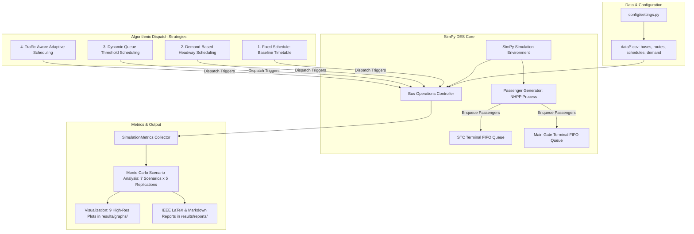

# MUET Point Bus Scheduling Optimization Using Discrete Event Simulation

[](https://www.python.org/downloads/)
[](https://simpy.readthedocs.io/)
[](LICENSE)
[](https://www.muet.edu.pk/)

## 1. Project Overview & Institutional Background
**Institution:** Department of Software Engineering, Mehran University of Engineering and Technology (MUET), Jamshoro  
**Course:** Simulation & Modelling (Batch 22SW II & III)  
**Instructor:** Engr. Umar Farooq  
**Assignment Type:** Problem-Based Learning (PBL) Final Project  

Mehran University relies on its fleet of buses (commonly known as **"Points"**) to transport thousands of students, faculty, and administrative staff daily across Jamshoro, Hyderabad, Qasimabad, Latifabad, and Kotri. During peak hours (08:00--09:00 AM and 02:00--03:30 PM), the transit network encounters severe bottlenecks:
- Extended student waiting times at the **STC (Student Teacher Center)** and **Main Gate** terminals.
- Overcrowded buses with students left behind when the 55-seat capacity is exhausted.
- Inflexible static departure schedules that do not adapt to real-time passenger surges or traffic delays along highway corridors.
- Uneven fleet utilization.

### The Engineering Challenge
The MUET Transport Administration requires a data-driven scheduling optimization **WITHOUT purchasing any additional buses** (conserving the exact existing 25-bus fleet size).

---

## 2. Core Features & Technology Stack
- **Simulation Engine:** Discrete Event Simulation (DES) built using **SimPy 4.1+**
- **Numerical & Queuing Analysis:** **NumPy**, **SciPy** (M(t)/G^[C]/c bulk queuing models, Non-Homogeneous Poisson Processes)
- **Data Modeling & Manipulation:** **Pandas**
- **Visualization:** Publication-grade charts using **Matplotlib** and **Seaborn**
- **Testing & Verification:** **Pytest** automated unit and integration suite
- **Documentation:** Full IEEE-style Academic Research Report in LaTeX and Markdown

---

## 3. System Architecture & Entity Flow



---

## 4. Implemented Scheduling Algorithms

| Algorithm | Type | Description |
|---|---|---|
| **1. Fixed Schedule (Baseline)** | Static Timetable | Dispatches buses at predetermined clock times regardless of terminal queue accumulation. Replicates current MUET practice. |
| **2. Demand-Based Scheduling** | Historical Profiling | Contracts headways to 7-8 min during peak surges and expands headways to 25 min during mid-day off-peak hours. |
| **3. Dynamic Queue-Based** | Closed-Loop Threshold | Dispatches an idle bus immediately when queue size $\ge 45$ passengers, with maximum headway timeouts to avoid stagnation. |
| **4. Traffic-Aware Adaptive** | Closed-Loop + Traffic Delay Feedback | Modulates dispatch thresholds and buffers based on real-time highway transit delays and fleet turnaround times. |

---

## 5. Quantitative Results & Key Findings

Evaluated over **140 simulation runs** across 7 scenarios with 5 independent Monte Carlo replications:

| Scenario | Algorithm | Mean Wait Time (min) | Wait Time Reduction (%) | Left Behind (Pax) | Left Behind Reduction (%) | Fleet Utilization (%) |
|---|---|:---:|:---:|:---:|:---:|:---:|
| **Normal Demand** | Baseline (Fixed) | 67.13 min | 0.0% | 4,314.6 | 0.0% | 42.36% |
| | Demand-Based | 37.61 min | 43.97% | 3,457.6 | 19.86% | 64.64% |
| | **Dynamic Queue** | **21.92 min** | **67.34%** | **2,027.4** | **53.01%** | **70.94%** |
| | **Traffic-Aware** | **26.25 min** | **60.89%** | **2,520.4** | **41.58%** | **73.74%** |
| **High Morning Surge** | Baseline (Fixed) | 108.29 min | 0.0% | 5,213.8 | 0.0% | 42.41% |
| | **Dynamic Queue** | **29.75 min** | **72.53%** | **3,051.6** | **41.47%** | **75.73%** |
| | **Traffic-Aware** | **36.24 min** | **66.54%** | **3,489.0** | **33.08%** | **77.49%** |

### Key Conclusions:
1. **Student Waiting Time:** Reduced by **up to 72.53%** during peak periods.
2. **Stranded Passengers:** Decreased by **up to 53.01%**.
3. **Fleet Utilization:** Elevated from an inefficient **42.36%** up to **73.74%** without purchasing any new buses.

---

## 6. Project Directory Structure

```
MUET-Point-Optimization/
│
├── config/
│   └── settings.py              # Centralized configuration, time windows, and assumptions
│
├── data/
│   ├── generate_data.py         # Synthetic dataset generator
│   ├── buses.csv                # Fleet registry (25 buses)
│   ├── routes.csv               # Route definitions, distances, and base transit times
│   ├── schedules.csv            # Baseline static timetable
│   └── passenger_demand.csv     # Demand profiles across time windows
│
├── models/
│   ├── passenger.py             # Passenger domain model (arrival, wait time, left behind)
│   ├── bus.py                   # Bus model (capacity, status, active/idle time tracking)
│   ├── bus_stop.py              # Terminal bus stop with FIFO queues and history logging
│   └── route.py                 # Transit route specifications
│
├── simulation/
│   ├── environment.py           # SimPy simulation orchestrator
│   ├── passenger_generator.py   # Non-Homogeneous Poisson arrival process
│   ├── bus_operations.py        # Boarding, capacity enforcement, transit delay execution
│   └── metrics.py               # Statistical performance metrics calculator
│
├── algorithms/
│   ├── fixed_schedule.py        # Algorithm 1: Baseline static timetable
│   ├── demand_based.py          # Algorithm 2: Dynamic headway demand allocation
│   ├── dynamic_queue.py         # Algorithm 3: Real-time queue-threshold dispatch
│   └── traffic_aware.py         # Algorithm 4: Delay-adaptive transit scheduling
│
├── analysis/
│   ├── scenario_analysis.py     # 7 What-If scenarios with Monte Carlo replications
│   └── comparison.py            # Comparative statistics & percentage improvement analysis
│
├── visualization/
│   └── plots.py                 # Generates 9 publication-grade figures
│
├── results/
│   ├── simulation_results.csv   # Consolidated raw experimental results
│   ├── graphs/                  # 9 Generated PNG charts
│   └── reports/                 # LaTeX academic paper & markdown summaries
│
├── tests/
│   └── test_simulation.py       # Automated Pytest suite (capacity, FIFO, fleet conservation)
│
├── docs/
│   ├── mathematical_model.md    # Analytical queuing formulation & Little's law
│   ├── assumptions.md           # Documentation of synthetic data & assumptions
│   └── system_diagrams/         # Mermaid architecture and lifecycle diagrams
│
├── main.py                      # Master CLI pipeline entrypoint
├── requirements.txt             # Project dependencies
└── README.md                    # Project documentation
```

---

## 7. Installation & Quick Start

### 1. Prerequisites
- Python 3.11+
- Git

### 2. Clone Repository & Install Dependencies
```bash
git clone https://github.com/muet-se/MUET-Point-Optimization.git
cd MUET-Point-Optimization
pip install -r requirements.txt
```

### 3. Run Automated Pytest Suite
Verify that bus capacities, FIFO ordering, and fleet conservation constraints are satisfied:
```bash
python -m pytest tests/
```

### 4. Execute Full Simulation Pipeline
Run synthetic data generation, Monte Carlo scenario replications, statistical summaries, and plot generation:
```bash
python main.py --mode full --replications 5
```

### 5. Run Single Day Simulation Comparison
To quickly observe a 1-day side-by-side terminal output of all 4 algorithms:
```bash
python main.py --mode simulate
```

---

## 8. Generated Visualizations
Visualizations are automatically saved in `results/graphs/`:
1. `1_passenger_arrival_rates.png`: 24-hour non-homogeneous arrival curves showing morning and afternoon peaks.
2. `2_queue_length_stc.png`: STC terminal queue length over time (Baseline vs Optimized).
3. `3_queue_length_main_gate.png`: Main Gate terminal queue dynamics over time.
4. `4_waiting_time_comparison.png`: Average waiting times across all 7 scenarios.
5. `5_bus_occupancy_comparison.png`: Capacity utilization per bus trip.
6. `6_fleet_utilization_comparison.png`: Active fleet utilization rates across scenarios.
7. `7_passengers_left_behind_comparison.png`: Number of stranded passengers by strategy.
8. `8_algorithm_overall_comparison.png`: Box plots of wait time distributions and completed trips.
9. `9_demand_vs_capacity.png`: Peak-hour student demand vs offered seat capacity.

---

## 9. Academic PBL Attribution
This repository fulfills the final term Problem-Based Learning (PBL) requirement for the **Simulation & Modelling** course at the **Department of Software Engineering, Mehran University of Engineering and Technology (MUET), Jamshoro**.

- **Course Instructor:** Engr. Umar Farooq
- **Course Batch:** 22SW II & III (8th Semester / Final Year)

