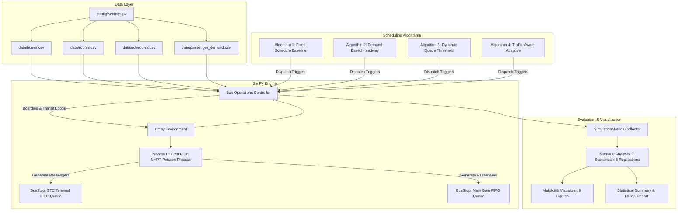
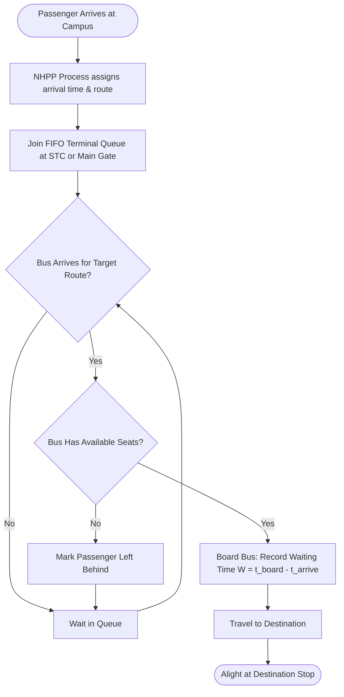
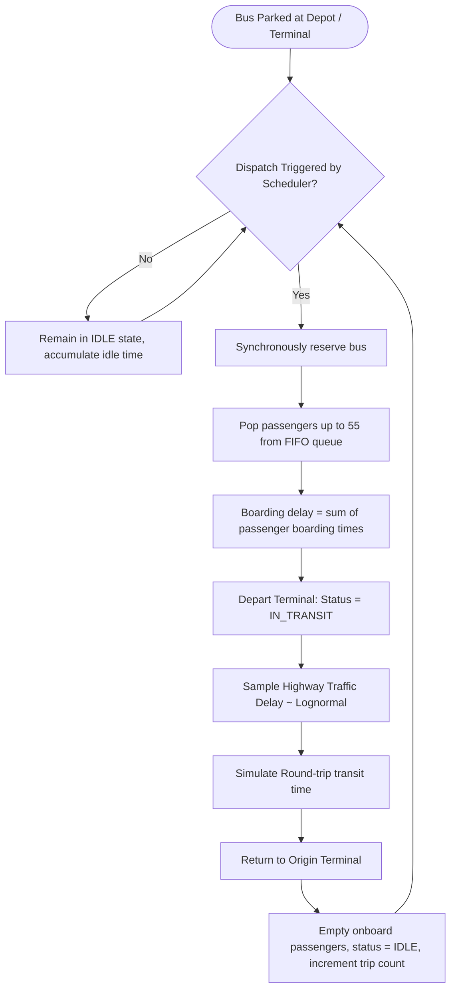

# System Diagrams: Architecture, State Transitions, and Lifecycles

This document describes the architectural topology and state transitions of the MUET Point Bus Scheduling Discrete Event Simulation system.

## 1. System Architecture Diagram



## 2. Bus State Transition Diagram

A Point bus can only transition between distinct deterministic states, guaranteeing no capacity violations or overlapping trips.

```mermaid
stateDiagram-v2
    [*] --> IDLE : Initial Fleet Allocation
    
    IDLE --> BOARDING : Dispatch Triggered (Algorithm)
    note right of BOARDING : Passengers board up to capacity 55\nTime: 1.5 - 3.0s per passenger
    
    BOARDING --> IN_TRANSIT : All Passengers Boarded & Doors Close
    note right of IN_TRANSIT : Route base transit time + \nLognormal Traffic Delay
    
    IN_TRANSIT --> IDLE : Bus Completes Round Trip at Origin Terminal
    note left of IDLE : Ready for next trip assignment
    
    IDLE --> MAINTENANCE : Mechanical Breakdown / Service
    MAINTENANCE --> IDLE : Restored to Fleet
```

## 3. Passenger Flowchart



## 4. Bus Lifecycle Flowchart



